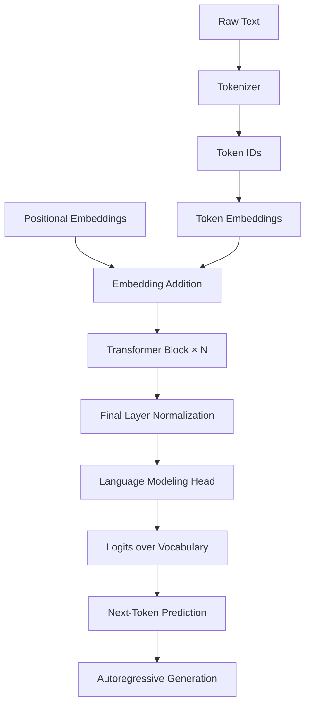

<!-- # GPT-2 From Scratch

### Building a GPT-2-Style Language Model from First Principles

<p align="center">
  
  
  
  
  
</p>

## Overview

**GPT-2 From Scratch** is an implementation of a GPT-2-style autoregressive language model built to understand and reproduce the core components of decoder-only Transformer architectures using PyTorch.

Rather than relying entirely on a pretrained language model, this project focuses on implementing the underlying architecture, tokenization pipeline, training workflow, and text-generation process from the ground up.

The project explores how raw text is transformed into tokens, how self-attention captures contextual relationships, how Transformer blocks learn language representations, and how next-token prediction enables autoregressive text generation.

The long-term objective is to build a reproducible, testable, and extensible language-modeling pipeline that demonstrates practical understanding of modern NLP and LLM engineering.

## Key Objectives

- Implement a decoder-only Transformer architecture inspired by GPT-2.
- Understand and implement causal multi-head self-attention.
- Build a tokenizer and vocabulary-processing pipeline.
- Implement token and positional embeddings.
- Train the model using next-token prediction and cross-entropy loss.
- Develop autoregressive text generation with configurable decoding strategies.
- Evaluate training performance using language-modeling metrics.
- Establish reproducible experiments, automated tests, and clear technical documentation.

## Architecture

The model follows the GPT-style decoder-only Transformer design.



### Core Components

| Component | Purpose |
|---|---|
| Tokenizer | Converts text into token IDs and reconstructs text from generated IDs. |
| Token embeddings | Maps token IDs to dense vector representations. |
| Positional embeddings | Encodes token-position information. |
| Causal self-attention | Enables each token to attend only to permitted preceding positions and itself. |
| Multi-head attention | Learns contextual relationships through multiple attention heads. |
| Layer normalization | Stabilizes activations during training. |
| GELU feed-forward network | Applies nonlinear transformations to contextual representations. |
| Residual connections | Improve information flow and optimization through deep networks. |
| Language modeling head | Maps hidden representations to vocabulary logits. |
| Autoregressive decoder | Generates text one token at a time. |

### Transformer Block

The current implementation uses **custom attention, pre-layer normalization, and a GELU-based feed-forward network**.

The intended block structure is:

```text
Input
  │
  ├── LayerNorm
  │      │
  │   Causal Multi-Head Self-Attention
  │      │
  └──── Residual Addition
         │
         ├── LayerNorm
         │      │
         │   Feed-Forward Network
         │   Linear → GELU → Linear
         │      │
         └──── Residual Addition
                │
              Output
```

For a pre-layer-normalized block, the computation can be expressed as:

\[
h' = h + \operatorname{Attention}(\operatorname{LN}_1(h))
\]

\[
h_{\text{out}} = h' +
\operatorname{MLP}(\operatorname{LN}_2(h'))
\]

The attention operation must use a causal mask so that a position cannot access future tokens during training.

> **Implementation note:** This describes the intended architecture. Verify the masking behavior, residual paths, embedding configuration, final normalization, and output-head behavior against the actual code before claiming complete GPT-2 architectural parity.

## Technology Stack

| Technology | Application |
|---|---|
| Python | Core implementation |
| PyTorch | Neural network modules, automatic differentiation, and optimization |
| NumPy | Numerical operations and data processing where needed |
| Matplotlib | Training curves and experiment visualization |
| pytest | Unit and regression testing |
| Git and GitHub | Version control and project collaboration |

The exact dependencies and supported Python versions should be pinned in the project's environment or dependency files.

## Project Structure

```text
gpt2-from-scratch/
├── configs/
│   └── model_config.yaml
├── data/
│   ├── raw/
│   └── processed/
├── notebooks/
│   └── exploration.ipynb
├── src/
│   ├── model/
│   │   ├── embeddings.py
│   │   ├── attention.py
│   │   ├── transformer_block.py
│   │   └── gpt_model.py
│   ├── tokenizer/
│   │   └── tokenizer.py
│   ├── training/
│   │   ├── dataset.py
│   │   ├── trainer.py
│   │   └── loss.py
│   ├── generation/
│   │   └── generate.py
│   └── utils/
│       └── reproducibility.py
├── tests/
│   ├── test_tokenizer.py
│   ├── test_attention.py
│   ├── test_model.py
│   └── test_generation.py
├── scripts/
│   ├── train.py
│   └── evaluate.py
├── checkpoints/
├── reports/
│   └── figures/
├── .gitignore
├── requirements.txt
├── LICENSE
└── README.md
```

*This is a recommended layout, not a claim that every file already exists in the current repository. Adapt the paths to the actual implementation.*

## Installation

### Prerequisites

- Python 3.10 or a compatible version supported by the pinned dependencies.
- Git.
- A CPU or CUDA-compatible PyTorch installation.
- Sufficient memory for the selected model configuration and training dataset.

### 1. Clone the repository

```bash
git clone https://github.com/<your-username>/<your-repository>.git
cd <your-repository>
```

Replace the placeholders with the actual GitHub username and repository name.

### 2. Create a virtual environment

**Windows — PowerShell**

```powershell
python -m venv .venv
.\.venv\Scripts\Activate.ps1
```

**Linux / macOS**

```bash
python3 -m venv .venv
source .venv/bin/activate
```

### 3. Install dependencies

```bash
python -m pip install --upgrade pip
pip install -r requirements.txt
```

Install a PyTorch build compatible with your operating system and hardware if it is not already specified correctly in the dependency configuration.

### 4. Verify PyTorch

```python
import torch

print("PyTorch version:", torch.__version__)
print("CUDA available:", torch.cuda.is_available())

if torch.cuda.is_available():
    print("GPU:", torch.cuda.get_device_name(0))
```

## Model Configuration

Keep model hyperparameters in a configuration file instead of scattering hard-coded values throughout the implementation.

Example configuration:

```yaml
model:
  vocab_size:  # Set from tokenizer vocabulary
  context_length: 512
  embedding_dim: 768
  num_heads: 12
  num_layers: 12
  dropout: 0.1

training:
  batch_size: 4
  learning_rate: 0.0003
  weight_decay: 0.01
  epochs: 10
  seed: 42

generation:
  max_new_tokens: 100
  temperature: 0.8
  top_k: 50
```

**Important:** These values are illustrative starting points, not verified project settings or a reproduction of the original GPT-2 training configuration. Select dimensions that fit the available hardware, ensure `embedding_dim` is divisible by `num_heads`, and configure the context length to match the positional embeddings.

## Training Pipeline

The training pipeline follows the standard causal language-modeling objective.

1. Load and clean the training corpus.
2. Train or initialize the tokenizer according to the chosen tokenization algorithm.
3. Encode text into token IDs.
4. Create input-target sequences using a one-token shift.
5. Run a forward pass through the model.
6. Calculate cross-entropy loss over the vocabulary.
7. Backpropagate gradients.
8. Update parameters using an optimizer.
9. Evaluate on held-out validation data.
10. Save checkpoints and training metrics.

For a token sequence:

```text
Input:   [The, model, learns, language]
Target:  [model, learns, language, ...]
```

The model learns to predict the next token from the preceding context.

The standard objective is:

\[
\mathcal{L} =
-\frac{1}{T}\sum_{t=1}^{T}
\log P(x_t \mid x_{<t})
\]

where \(x_{<t}\) represents all preceding tokens available to the model at position \(t\).

Use a held-out validation set to monitor generalization and detect overfitting.

## Text Generation

Once trained, the model can generate text autoregressively:

1. Encode a prompt using the project tokenizer.
2. Pass the token IDs through the model.
3. Obtain logits for the next token.
4. Apply the selected decoding strategy.
5. Sample or select the next token.
6. Append the token to the sequence.
7. Repeat until the generation limit or a stopping condition is reached.
8. Decode the generated IDs into text.

Example interface, assuming the project exposes a compatible `generate` method:

```python
prompt = "Artificial intelligence is"

generated_ids = model.generate(
    input_ids,
    max_new_tokens=100,
    temperature=0.8,
    top_k=50,
)
```

Adapt the method signature and tokenizer calls to the actual implementation.

Possible decoding strategies include:

- Greedy decoding
- Temperature sampling
- Top-k sampling
- Top-p (nucleus) sampling

Temperature and sampling settings affect diversity and repetition, but they cannot compensate for insufficient training or a poorly learned language model.

## Testing and Validation

Automated tests should validate the implementation independently of training quality.

| Test area | Expected validation |
|---|---|
| Tokenizer | Encoding and decoding behave consistently; unknown or unsupported input is handled explicitly. |
| Attention | Output shapes are correct and future-token information is blocked. |
| Transformer block | Input and output shapes agree when residual dimensions are unchanged. |
| Model forward pass | Logits have shape `[batch_size, sequence_length, vocab_size]`. |
| Loss | Cross-entropy loss is finite and gradients propagate. |
| Optimization | A training step updates trainable parameters. |
| Generation | Output respects the maximum sequence length and generation limit. |
| Reproducibility | Controlled seeds produce repeatable results where supported. |
| Checkpointing | Model and optimizer states can be saved and restored. |

Run tests with:

```bash
pytest -q
```

Add integration tests for the full pipeline and regression tests for previously fixed bugs.

## Evaluation Metrics

Training loss alone is not enough to establish that the model learns useful language patterns.

Recommended metrics include:

- **Training loss:** Measures fit to the training corpus.
- **Validation loss:** Measures performance on held-out text.
- **Perplexity:** Exponentiated average token-level negative log-likelihood.
- **Training throughput:** Tokens processed per second.
- **Peak memory usage:** Tracks resource requirements.
- **Generation latency:** Measures the time required to produce tokens.
- **Qualitative generation:** Examines coherence, repetition, and prompt relevance.

For average cross-entropy loss measured in natural logarithms:

\[
\operatorname{Perplexity} = e^{\mathcal{L}_{\text{validation}}}
\]

Compare results using the same dataset split, tokenizer, context length, and evaluation protocol. Perplexity values from different tokenization schemes may not be directly comparable.

### Experimental Results

| Metric | Result |
|---|---|
| Training dataset | To be measured |
| Number of model parameters | To be measured |
| Training steps / epochs | To be measured |
| Final training loss | To be measured |
| Final validation loss | To be measured |
| Validation perplexity | To be measured |
| Tokens per second | To be measured |
| Hardware | To be recorded |

Populate this table only after running reproducible experiments. Include the dataset, configuration, and evaluation conditions when reporting results.

## Engineering Practices

The project aims to follow practical ML engineering conventions:

- **Configuration-driven experiments:** Store hyperparameters and training settings in version-controlled configuration files.
- **Reproducibility:** Set random seeds and record environment details.
- **Separation of concerns:** Keep model architecture, tokenization, training, evaluation, and generation in separate modules.
- **Checkpointing:** Save model weights and the configuration needed to reproduce a run.
- **Automated testing:** Validate tensor shapes, masking, gradients, and generation behavior.
- **Data management:** Keep large datasets and generated artifacts out of Git when appropriate.
- **Experiment tracking:** Record losses, evaluation metrics, runtime, and hardware.
- **Code quality:** Use clear naming, type hints where useful, linting, and formatting.
- **Documentation:** Document configuration fields, expected inputs, outputs, and known limitations.

Do not commit private datasets, credentials, large checkpoints, or environment-specific files. Document how to obtain or recreate any required data.

## Current Development Roadmap

- [x] Implement a custom attention mechanism.
- [x] Implement pre-layer normalization.
- [x] Implement a GELU-based feed-forward network.
- [ ] Validate causal masking and attention behavior.
- [ ] Complete and verify the end-to-end GPT-style model.
- [ ] Finalize and test the custom tokenizer.
- [ ] Validate the next-token training objective.
- [ ] Implement a reproducible training pipeline.
- [ ] Add checkpoint saving and restoration.
- [ ] Implement and test autoregressive text generation.
- [ ] Evaluate validation loss and perplexity.
- [ ] Add automated tests and performance benchmarks.
- [ ] Document experiments and publish example outputs.

The checked items describe the implementation state reported during development; they are not a substitute for automated tests. Update this checklist as features are completed and verified.

## Known Limitations

The current development stage may have limitations that need to be addressed before the model is ready for practical use:

- Model quality depends on the training corpus, tokenizer, training duration, and compute budget.
- A GPT-2-style implementation does not automatically reproduce the original pretrained GPT-2 weights or results.
- Training from random initialization requires substantially more data and compute than fine-tuning a pretrained model.
- Generation quality and benchmark performance must be measured rather than assumed.
- Memory consumption and training speed depend on model dimensions, batch size, context length, and hardware.

## Future Improvements

Potential extensions include:

- Mixed-precision training and gradient accumulation.
- Learning-rate warmup and cosine decay.
- Gradient clipping and improved checkpoint management.
- Efficient attention implementations and profiling.
- Training on a documented, appropriately licensed corpus.
- Comparison against a smaller baseline language model.
- Experiment tracking and automated evaluation.
- A command-line interface for training, evaluation, and generation.
- A lightweight inference demo or API after the core pipeline is validated.

## Learning Outcomes

This project is designed to develop hands-on understanding of:

- Transformer internals and causal attention.
- Tokenization and vocabulary design.
- Embedding representations and positional information.
- Backpropagation and language-modeling objectives.
- Autoregressive decoding.
- PyTorch model development and debugging.
- Reproducible experiments and evaluation.
- Practical machine-learning engineering workflows.

## Contributing

Contributions and suggestions are welcome.

1. Fork the repository.
2. Create a feature branch.
3. Implement the change with appropriate tests.
4. Run the test suite.
5. Submit a pull request describing the change and its validation.

Please keep changes focused, document important architectural decisions, and avoid committing datasets or checkpoints unnecessarily.

## License

This project is intended to use the MIT License. Add a `LICENSE` file containing the appropriate license text before distributing the project under that license.

## Acknowledgments

- The original GPT-2 research and architecture introduced by OpenAI.
- The PyTorch team for its deep-learning framework.
- The open-source NLP community for educational resources and implementation references.

## Author

**Shri Kishan**

- GitHub: [shriKishan-21](https://github.com/shriKishan-21)
- LinkedIn: [Shri Kishan](https://www.linkedin.com/in/shri-kishan-00989431a)

---

*This project is an educational implementation of a GPT-2-style language model. Architectural completeness, training performance, and equivalence to the original GPT-2 should be established through code verification and reproducible experiments.* -->
